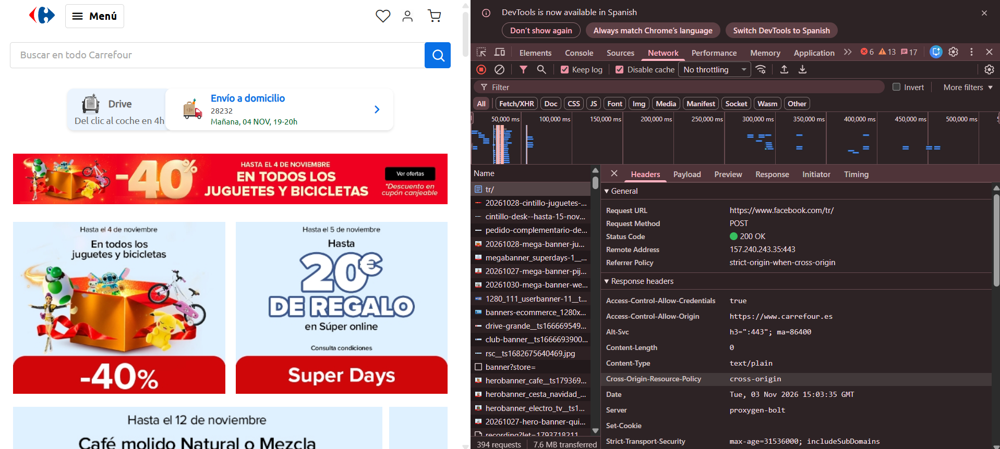
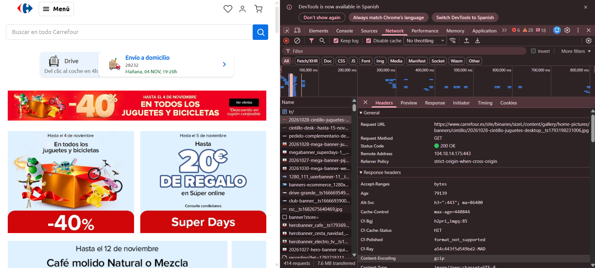
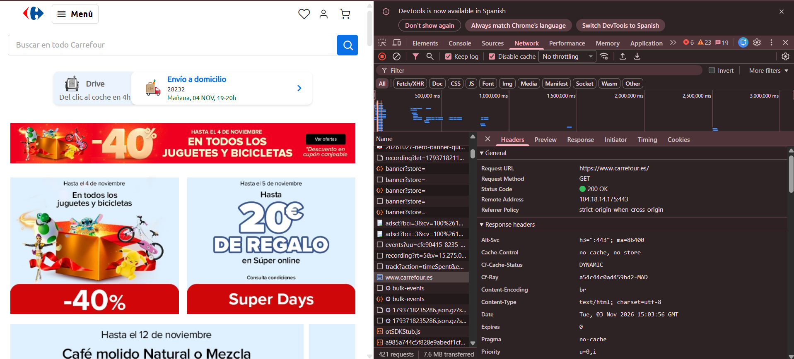

# Ficha-8---Mini-proyecto-UT1
# Análisis cliente-servidor de Carrefour

**Web analizada:** [https://www.carrefour.es/](https://www.carrefour.es/)

## 1. Introducción

El objetivo de esta práctica es analizar la web de Carrefour España para identificar las partes que corresponden al frontend y al backend, comprender el funcionamiento del modelo cliente-servidor y estudiar tres peticiones HTTP utilizando las herramientas de desarrollo del navegador.

## 2. Frontend y backend

### 2.1. Frontend

El frontend es la parte de la web con la que interactúa directamente el usuario. En Carrefour podemos encontrar los siguientes elementos:

- **HTML:** define la estructura de la página, como los menús, los productos, los textos y los formularios.
- **CSS:** controla el diseño visual, los colores, los tamaños y la distribución de los elementos.
- **JavaScript:** permite implementar funcionalidades interactivas, como la búsqueda de productos, los menús y la actualización de información.
- **Imágenes y otros recursos:** incluyen fotografías de productos, banners publicitarios, logotipos e iconos.

El navegador descarga e interpreta estos recursos para mostrar la página al usuario.

### 2.2. Backend

El backend es la parte que funciona en los servidores y se encarga de procesar las solicitudes del cliente. En una tienda online como Carrefour, estas funciones pueden incluir:

- Consultar información de productos y precios.
- Gestionar el carrito de compra.
- Procesar pedidos.
- Gestionar cuentas de usuario y sesiones.
- Consultar la disponibilidad de productos.

Estas operaciones pueden utilizar servicios de aplicación, APIs y bases de datos. La implementación interna concreta de Carrefour no se puede conocer únicamente observando la página desde el navegador.

## 3. Funcionamiento del modelo cliente-servidor

La web de Carrefour utiliza el modelo cliente-servidor, habitual en las aplicaciones web.

Su funcionamiento se puede resumir en los siguientes pasos:

1. El usuario introduce la dirección de Carrefour en el navegador.
2. El navegador, que actúa como cliente, envía una petición HTTP o HTTPS al servidor.
3. El servidor procesa la petición y devuelve los recursos solicitados, como el documento HTML, las hojas de estilo, los archivos JavaScript y las imágenes.
4. El navegador interpreta los recursos recibidos y muestra la página.
5. Cuando el usuario realiza una acción, como buscar un producto, el navegador puede enviar nuevas peticiones al servidor.
6. El servidor procesa esas solicitudes y devuelve los datos o resultados correspondientes.

**Esquema del modelo cliente-servidor:**

`Usuario → Navegador (cliente/frontend) → Petición HTTP/HTTPS → Servidor (backend) → Respuesta → Navegador`

La pestaña Network de las herramientas de desarrollo permite observar las peticiones y respuestas que se producen durante la navegación.

## 4. Análisis de tres peticiones HTTP

Para realizar el análisis se han utilizado las herramientas de desarrollo de Chrome, concretamente la pestaña **Network**, mientras se visitaba la web de Carrefour.

En cada petición se ha comprobado el método HTTP, el código de estado y la cabecera `Content-Type`.

### 4.1. Petición 1: seguimiento de actividad de Facebook

- **URL:** `https://www.facebook.com/tr/`
- **Método HTTP:** `POST`
- **Código de estado:** `200 OK`
- **Content-Type:** `text/plain`

**¿Qué solicita?**

Esta petición se envía a Facebook y está relacionada con el seguimiento de actividad web, habitualmente mediante el píxel de Meta. Puede utilizarse para registrar eventos y medir la actividad de los usuarios en una página.

El método `POST` permite enviar información al servidor. El código `200 OK` indica que la petición se ha procesado correctamente.

Aunque aparece durante la visita a Carrefour, esta petición se dirige a Facebook, no al servidor principal de Carrefour.

### 4.2. Petición 2: descarga de una imagen promocional

- **URL:** recurso de imagen alojado en `www.carrefour.es`, dentro de la ruta de banners.
- **Método HTTP:** `GET`
- **Código de estado:** `200 OK`
- **Content-Type:** `image/jpeg` (comprobar el valor completo en DevTools).

**¿Qué solicita?**

El navegador solicita al servidor de Carrefour una imagen JPEG correspondiente a un banner promocional.

El método `GET` se utiliza para solicitar un recurso al servidor. La respuesta `200 OK` indica que la solicitud se ha procesado correctamente y el tipo de contenido identifica el recurso como una imagen JPEG.

Esta petición permite observar cómo el frontend obtiene las imágenes que después se muestran en la página.

### 4.3. Petición 3: documento HTML principal

- **URL:** `https://www.carrefour.es/`
- **Método HTTP:** `GET`
- **Código de estado:** `200 OK`
- **Content-Type:** `text/html; charset=utf-8`

**¿Qué solicita?**

El navegador solicita el documento HTML principal de la web de Carrefour.

El servidor devuelve una respuesta `200 OK` con contenido HTML codificado en UTF-8. El navegador interpreta este documento para construir la estructura de la página, que posteriormente se completa con otros recursos, como hojas de estilo, archivos JavaScript e imágenes.

Esta petición es un ejemplo directo de la comunicación entre el navegador del usuario y el servidor de la web.

## 5. Comparación de las peticiones

| Petición | Método | Estado | Content-Type | Finalidad |
|---|---|---|---|---|
| Seguimiento de Facebook | POST | 200 OK | `text/plain` | Enviar información relacionada con la actividad web. |
| Imagen promocional | GET | 200 OK | `image/jpeg`* | Descargar una imagen de Carrefour. |
| Página principal | GET | 200 OK | `text/html; charset=utf-8` | Descargar el documento HTML principal. |

\*El valor completo de `Content-Type` de la imagen debe verificarse en la respuesta de DevTools.

## 6. Capturas de pantalla

### Petición 1: seguimiento de Facebook

### Petición 2: imagen promocional de Carrefour

### Petición 3: página principal de Carrefour

## 7. Conclusión

La práctica permite comprender cómo funciona el modelo cliente-servidor en una tienda online como Carrefour.

El frontend se encarga de mostrar la página y permitir la interacción del usuario, mientras que el backend procesa las solicitudes y proporciona los datos necesarios.

El análisis de Network demuestra que el navegador realiza diferentes tipos de peticiones: solicita el documento HTML principal, descarga imágenes y puede comunicarse con servicios externos de seguimiento. Las cabeceras HTTP permiten identificar el método utilizado, el resultado de la petición y el tipo de contenido recibido.
